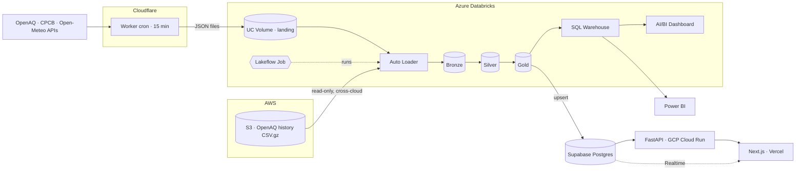

# AERIS — Smart City Air Quality Intelligence Platform

Real air-quality data for **Delhi NCR**, processed with **Apache Spark on Azure Databricks** through a Delta Lake **Bronze → Silver → Gold** pipeline. The pipeline is automated by a **Lakeflow Job** and fed continuously by **Auto Loader** streaming. Results are served to a **Next.js** web app, a **Databricks AI/BI dashboard** and a **Power BI** report.

> University Big Data project · PySpark · deadline 20 Nov 2026

## Architecture at a glance



Each cloud does one real job. See [docs/architecture.md](docs/architecture.md).

| Platform | Job |
|---|---|
| Azure Databricks | Spark processing, Delta medallion, Unity Catalog, Jobs, Auto Loader, SQL Warehouse, AI/BI dashboard |
| AWS S3 | Historical archive: OpenAQ hourly CSV.gz, read cross-cloud by Unity Catalog |
| Cloudflare Workers | Free always-on collector that lands live JSON every 15 minutes |
| GCP | Cloud Run hosts FastAPI; Google Maps + Air Quality heatmap in the web app |
| Supabase | Serving Postgres for the web app + Realtime "data updated" signal |
| Power BI | Enterprise report on Gold via the Databricks SQL Warehouse |

## Repo

```
databricks/   bundle: job, notebooks, helpers, dashboard, tests
apps/api      FastAPI        apps/web   Next.js        apps/collector  Cloudflare Worker
supabase/     migrations     powerbi/   AERIS.pbip     docs/  everything explained
```

## Start here

1. [docs/setup.md](docs/setup.md) — install CLIs, log in, add secrets
2. [docs/task.md](docs/task.md) — the checklist we build from
3. [docs/demo-script.md](docs/demo-script.md) — how to present it

## Data sources

For a plain-language explanation of each dataset, why it was selected, and how the Power BI tables connect, read the [dataset README](powerbi/README.md).

[OpenAQ](https://openaq.org) (license per data provider, returned by the API) · [CPCB via data.gov.in](https://www.data.gov.in/catalog/real-time-air-quality-index) (GODL-India) · [Open-Meteo](https://open-meteo.com) (CC BY 4.0) · [Google Air Quality API](https://developers.google.com/maps/documentation/air-quality) (display only). Details and attribution are in [docs/data-sources.md](docs/data-sources.md).
