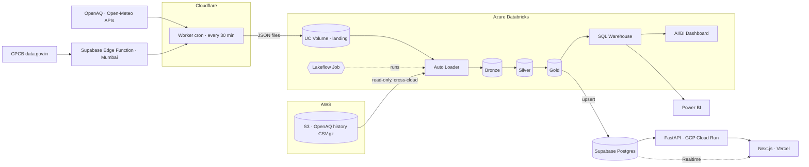

# AERIS — Smart City Air Quality Intelligence Platform

Real air-quality and weather data for **Delhi NCR** (Delhi, Gurugram, Noida, Ghaziabad, Faridabad), processed with **Apache Spark (PySpark) on Azure Databricks** through a Delta Lake **Bronze → Silver → Gold** pipeline. A **Lakeflow Job** runs everything in order, **Auto Loader** streams new files into Bronze, and the results reach a **Next.js** website, a **Databricks AI/BI dashboard** and a **Power BI** report.

> University Big Data project · PySpark · Azure Databricks · deadline 20 Nov 2026
> Live site: [aeris.inerate.com](https://aeris.inerate.com) · API: [aeris-api (Cloud Run)](https://aeris-api-70530354318.asia-south1.run.app/health)

## Why this project matters

Every November and December the air in Delhi NCR turns "Very Poor" or "Severe". The data to understand this exists, but it is scattered: government feeds, an international sensor archive and a separate weather service, each in its own format. AERIS brings them together into one clean, trustworthy dataset and shows when, where and why the air gets bad.

**One rule all through: real data only.** No number is made up. Missing data stays missing and is labelled. PM2.5 (a concentration in µg/m³) and AQI (an index from 0 to 500) are kept in separate columns, and AQI follows the CPCB **NAQI** method.

## Team and contributions

| Member | Part |
|---|---|
| **Piyush** | Data collection (ingestion), the ETL pipeline `aeris_etl` (Bronze, Silver, Gold) and the Lakeflow Job `aeris_pipeline` |
| **Bhumika** | Dashboards: Databricks AI/BI dashboard and the Power BI report (`powerbi/AERIS.pbip`) |
| **Yashraj** | ETL pipeline `aeris_etl` (Bronze, Silver, Gold), plus the website: Next.js frontend (Vercel) and FastAPI backend (Cloud Run) on Supabase |

## Architecture



Simple flow: **APIs + S3 → Landing (Volume) → ETL pipeline (Bronze, Silver, Gold) → Validate → Supabase → Website / dashboards.**

| Platform | Job |
|---|---|
| Azure Databricks | Spark processing, Delta medallion, Unity Catalog, Jobs, Auto Loader, SQL Warehouse, AI/BI dashboard |
| AWS S3 | Historical archive (OpenAQ CSV.gz), read cross-cloud through a Unity Catalog external location |
| Cloudflare Workers | Free always-on collector that lands live JSON every 30 minutes |
| Supabase | Serving Postgres for the website, Realtime "data updated" signal, and the Mumbai Edge Function for CPCB |
| GCP | Cloud Run hosts FastAPI; Google Maps + Air Quality heatmap in the web app |
| Power BI | Report on Gold through the Databricks SQL Warehouse |

Details: [docs/architecture.md](docs/architecture.md).

## 1. Data collection (ingestion)

Four real sources. Each one has a different job.

| Source | Brought in by | What it gives | Why we need it | Limit |
|---|---|---|---|---|
| **OpenAQ API** | `01_ingest_batch` (stations) + Cloudflare Worker (latest readings) | Station list (name, lat/lon, provider, licence) and the latest PM2.5, PM10, NO₂, O₃, SO₂, CO per sensor, for the NCR bounding box | Tells us where the sensors are; powers the map, station ranking and "air right now" | Free API key, 60 requests/min |
| **OpenAQ archive (AWS S3)** | Auto Loader through a read-only UC external location | Past readings per station from Jan 2025, one value per sensor every 15 min, for **62 reference monitors** (35,540 files, 161 MB copied to our private bucket) | Trends, calendar and seasonal patterns need long history; pulling it from the API would be slow | About 4 days of lag (the collector covers the newest days); CO unit looks wrong, so CO is kept out of NAQI |
| **CPCB (data.gov.in)** | Cloudflare Worker → Supabase Edge Function in Mumbai | Official real-time AQI feed for Delhi, Haryana, UP: station, city, last_update, pollutant, min/max/avg | The official Indian regulator's source; we land it every 30 min and build our own history (from 16 Nov 2026) | Latest snapshot only; accepts connections only from India. Kept in Bronze only until the meaning of `avg_value` is confirmed |
| **Open-Meteo** | `01_ingest_batch` (history) + Cloudflare Worker (live) | Hourly temperature, humidity, wind speed/direction, rain, pressure for the 5 cities | Pollution makes sense only next to the weather (calm wind → PM2.5 rises) | Model (reanalysis) data, labelled "modeled", not a sensor |

**How it lands.** Raw data is saved exactly as it arrives: one JSON file per call with `source`, `fetched_at` and the payload, in the volume `aeris_brick.default.aeris/landing/`. If anything breaks later, we reprocess from these files.

- **Live:** the Cloudflare Worker (`apps/collector`) runs two crons, each every 30 minutes (OpenAQ half + CPCB, then OpenAQ half + weather), and drops JSON into the Volume.
- **Batch:** the notebook `01_ingest_batch` uses plain Python `requests` (no Spark) for stations and weather history.
- **Problem we solved:** data.gov.in accepts only Indian IPs, but Cloudflare runs from abroad (521/500 errors). A Supabase Edge Function pinned to Mumbai (ap-south-1) now fetches CPCB for the Worker.

Licences: OpenAQ (per data provider), CPCB via data.gov.in (GODL-India), Open-Meteo (CC BY 4.0), Google Air Quality API (display only). Full details: [docs/data-sources.md](docs/data-sources.md) and the plain-language [dataset README](powerbi/README.md).

## 2. ETL pipeline — `aeris_etl`

A **declarative Lakeflow pipeline** (`databricks/resources/aeris_etl.pipeline.yml`, code in `databricks/src/etl/`, 10 Python files). Each function marked `@dp.table` or `@dp.materialized_view` creates one table. There is no main file: Databricks reads every `spark.read.table(...)`, builds the dependency graph itself and runs independent tables in parallel (weather runs in its own lane next to pollution).

| Layer | Tables | What happens |
|---|---|---|
| **Bronze** (raw, streaming tables via Auto Loader) | `station_raw`, `weather_raw`, `openaq_latest_raw`, `cpcb_aqi_raw`, `openaq_archive_raw` | Data as received, plus source file and `ingested_at` |
| **Silver** (clean) | `stations`, `pollutant_observations`, `weather_hourly` | Fix types, drop duplicates, attach the city, convert ppb → µg/m³, hourly averages; archive weather preferred over forecast for the same hour |
| **Gold** (final, materialized views) | `city_daily_aqi`, `station_daily_aqi`, `pollutant_trends`, `weather_pollution_daily`, `station_status`, `latest_city_status` | Daily NAQI per station and per city, trends, pollution next to weather, freshness status |

Key rules inside the pipeline:

- **Data quality:** `expect_or_drop` rules drop rows with no value, a negative value, a bad timestamp, impossible PM2.5, or no city.
- **NAQI method:** one daily value per station and pollutant: 24-hour mean (ozone uses the max 8-hour mean). A day needs at least **16 hours** of data.
- **Reference tables** `dim_city` and `dim_pollutant` are made once by `00_setup`; the pipeline only reads them.
- **No UDFs**, only built-in Spark functions. `serverless: true`, `continuous: false`: compute stops when the run ends.

**Scale (verified, see [docs/task.md](docs/task.md)):** 62 stations · 5 cities · Jan 2025 → Nov 2026 · **27.7M raw rows → 4.4M hourly → 2,863 city-days**.

Table columns, grain and keys: [docs/data-model.md](docs/data-model.md).

## 3. Job pipeline — `aeris_pipeline`

The job is the orchestrator. It is defined as YAML in a **Databricks Asset Bundle** (`databricks/resources/aeris_pipeline.job.yml`), versioned in git and deployed with one command (Infrastructure as Code).

```
ingest_batch → etl_bronze_silver_gold → validate_gold → sync_supabase
```

| Task | What it does | Safety |
|---|---|---|
| `ingest_batch` | Notebook `01_ingest_batch`: OpenAQ stations + weather JSON | 2 retries, 30 min timeout |
| `etl_bronze_silver_gold` | Runs the pipeline `aeris_etl` | Whole job times out at 50 min |
| `validate_gold` | Notebook `05_validate_gold`: unique keys, NAQI in 0–500, non-zero counts; writes `ops.table_stats` | If it fails, sync does not run |
| `sync_supabase` | Notebook `06_sync_supabase`: upserts `gold.*` into Supabase `public.*` (`ON CONFLICT DO UPDATE`), logs `ops.sync_runs` | 2 retries; reruns make no duplicates |

**If validation fails, sync does not run, so the website keeps the last good data, never bad data.** A full run takes about 33 minutes (last verified SUCCESS: 16 Nov 2026).

Other jobs in the bundle:

| Job | Purpose |
|---|---|
| `aeris_setup` | One-time setup: schemas, `dim_city`, `dim_pollutant` |
| `aeris_backfill` | One-off OpenAQ history backfill (`02_backfill_openaq`) |
| `aeris_live` | File-arrival trigger (ETL → validate → sync). **Paused** to save cost; unpaused only for a demo |

**Idempotency:** the Auto Loader checkpoint reads each file once, Gold is fully recomputed from the same input, and Supabase uses upsert. A rerun does not change row counts. More: [docs/pipelines.md](docs/pipelines.md).

## 4. Serving and dashboards

- **Supabase** holds the synced Gold tables (schema only through `supabase/migrations/`).
- **FastAPI** (`apps/api`, Cloud Run): `/api/v1/cities/latest`, `/stations`, `/cities/{city}/daily`, `/trends/pollutants`, `/weather/correlation`, `/pipeline/runs` (+ SSE). Contract: [docs/api.md](docs/api.md).
- **Next.js** (`apps/web`, Vercel): Server Components cached for an hour, refreshed by `revalidateTag` after sync and Supabase Realtime. No browser polling.
- **Databricks AI/BI dashboard** and **Power BI** (`powerbi/AERIS.pbip`) read Gold through the SQL Warehouse `aeris-wh`. See [docs/dashboards.md](docs/dashboards.md).

## Cost and safety

- `aeris_pipeline` is **manual** (no schedule), and `aeris_live` is paused, so nothing bills without a reason.
- Serverless tasks stop when they finish; every job has a timeout; the SQL warehouse auto-stops after 1 minute idle; an Azure budget alert is set.
- Secrets live in the Databricks secret scope `aeris`, Worker secrets, Supabase function secrets and Cloud Run/Vercel env. Nothing is in git. S3 is read through a UC storage credential (IAM role), no access keys.

Cost model: [docs/cost.md](docs/cost.md).

## Honest limits

- The collector lands data every 30 minutes, but the website changes only when the job runs, and the job is manual. So it is "data arrives every 30 minutes", not "real-time".
- Weather is Open-Meteo model data, not a sensor reading.
- The CO unit in the OpenAQ archive looks wrong, so CO is not used in NAQI.
- The archive lags by a few days; the newest days come from the collector.
- CPCB is collected into Bronze but not yet used in Silver or Gold.

## Repo

```
databricks/          bundle: resources (jobs, pipeline, dashboard), src/etl, src/notebooks, tests
apps/collector/      Cloudflare Worker (live JSON → Volume)
apps/api/            FastAPI (Cloud Run)
apps/web/            Next.js (Vercel)
supabase/            migrations + Edge Function
powerbi/             AERIS.pbip (TMDL model + PBIR report)
docs/                everything explained
```

## Run it

```bash
# Databricks (from databricks/)
databricks bundle validate && databricks bundle deploy
databricks bundle run aeris_pipeline        # ~33 min, billable

# Tests
uv run pytest databricks/tests apps/api/tests

# API (apps/api) · Web (apps/web) · Collector (apps/collector)
uv run fastapi dev app/main.py
npm run dev
npx wrangler dev
```

## Start here

1. [docs/setup.md](docs/setup.md) — install CLIs, log in, add secrets
2. [docs/task.md](docs/task.md) — the checklist we built from
3. [docs/demo-script.md](docs/demo-script.md) — how to present it
4. [docs/decisions.md](docs/decisions.md) — why we chose what we chose
5. [docs/learning.md](docs/learning.md) — concept notes
