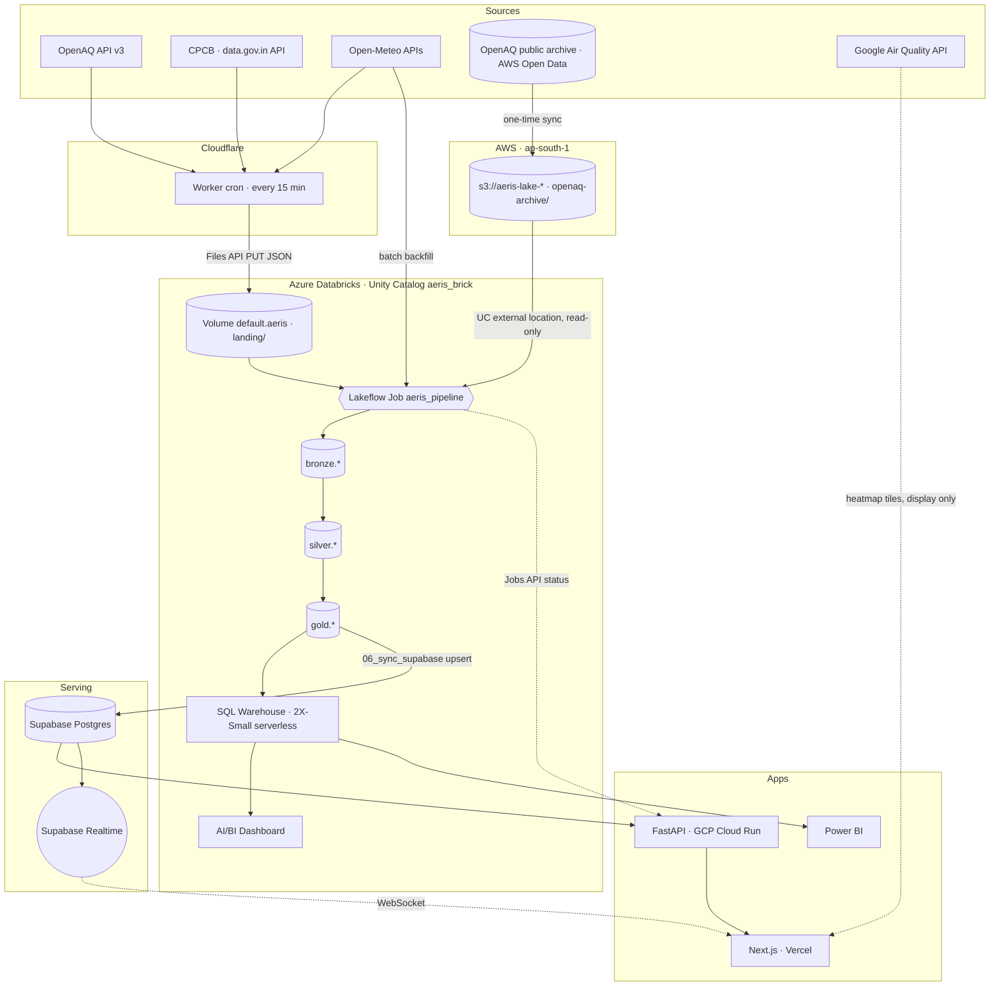
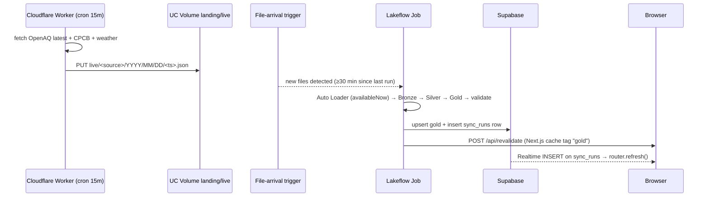
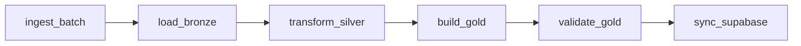

# Architecture

## 1. System context

## 2. Each platform's one job

| Platform | Job | Why this and not something else |
|---|---|---|
| **Azure Databricks** | All processing: Spark, Delta, Unity Catalog, Auto Loader, Lakeflow Jobs, SQL Warehouse, AI/BI dashboard | It's the course platform; the existing catalog `aeris_brick` lives here |
| **AWS S3** | Historical archive (OpenAQ hourly CSV.gz, Delhi NCR subset, ~2 years) | OpenAQ already publishes its archive on AWS Open Data; S3 is the natural home. Azure reads it cross-cloud, read-only |
| **Cloudflare Worker** | Collector: fetch latest readings every 15 min and land them as JSON files | Free, always on, and needs no Spark compute just to call an API |
| **Supabase** | Serving DB for the web app + Realtime change signal | Free; web traffic must not keep a SQL Warehouse running |
| **GCP** | Cloud Run hosts FastAPI; Maps JS + Air Quality heatmap overlay | Free tier, near the data (asia-south1); Google's map and AQ layer look premium |
| **Vercel** | Hosts Next.js | Best Next.js support; free hobby plan |
| **Power BI** | Enterprise report on Gold through the SQL Warehouse | The industry BI tool; star schema + DAX |

## 3. Data flow: two paths into one pipeline

**Batch (history):**
`OpenAQ archive (S3 CSV.gz)` + `Open-Meteo archive API` → `01_ingest_batch` / Auto Loader → Bronze → Silver → Gold.

**Near-real-time (streaming):**

What "streaming" means here, honestly: **Spark Structured Streaming runs through Auto Loader** with `trigger(availableNow=True)`. Each run reads only the files that are new since the checkpoint, then stops. The REST API calls themselves are polling, not streaming. The UI says "near-real-time (15-min snapshots)".

## 4. Lakeflow Job DAG

- Triggers: **file arrival** on `/Volumes/aeris_brick/default/aeris/landing/live/` (paused outside demos) + manual **Run now** (UI, CLI, or the web Pipeline page).
- A failed upstream task stops everything downstream, so incomplete Gold is never published. `validate_gold` is the gate before `sync_supabase`.
- Details: [pipelines.md](pipelines.md).

## 5. Serving + caching (no Redis, no browser polling)

| Layer | Cache | Invalidation |
|---|---|---|
| Supabase | none needed: small indexed tables | — |
| FastAPI | none; async queries are a few ms | — |
| Next.js | `fetch(…, { next: { revalidate: 300, tags: ['gold'] } })` in Server Components | `sync_supabase` POSTs `/api/revalidate` → `revalidateTag('gold')` |
| Browser | React Server Component payload | Supabase Realtime `INSERT` on `sync_runs` → `router.refresh()` |
| Pipeline page | live | FastAPI **SSE** stream; FastAPI polls the Databricks Jobs API every 3 s **only while a run is active** (a documented limit: Databricks can't push task progress to us) |

Why no Redis: Gold is a few thousand rows that change at most every 30 minutes. A Next.js tag cache plus Realtime covers this with zero extra services ([decisions.md](decisions.md) D-004).

## 6. Security + secrets map

| Secret | Lives in | Used by |
|---|---|---|
| OpenAQ key, data.gov.in key | Databricks scope `aeris`; Worker secrets | `01_ingest_batch`, collector |
| Databricks service principal (client id/secret) | Worker secrets; Cloud Run env | collector (Files API), FastAPI (Jobs API) |
| Supabase `aeris_sync` DB URL | Databricks scope `aeris` only | `06_sync_supabase` |
| Supabase `aeris_api` DB URL (read-only) | Cloud Run env | FastAPI |
| Supabase anon key | Vercel env (public by design; RLS limits it to `sync_runs` SELECT) | browser Realtime |
| Google Maps key | Vercel env (public by design; HTTP-referrer + API restricted, quota-capped) | browser |
| `API_ADMIN_KEY`, `REVALIDATE_SECRET` | Cloud Run / Vercel env, Databricks scope | run-now endpoint, revalidate hook |

Trust boundaries:
- The browser only ever talks to FastAPI, Supabase Realtime (anon, read-only `sync_runs`) and Google Maps.
- No Databricks token ever reaches the browser.
- `POST /pipeline/runs` needs the admin key and has a cooldown, because it starts billable compute.

## 7. Regions

Supabase `ap-south-1` (Mumbai) · S3 `ap-south-1` · Cloud Run `asia-south1` (Mumbai) · Azure Databricks: the workspace's existing region (to be confirmed at setup). Keeping everything in India keeps latency low and avoids moving data around.
