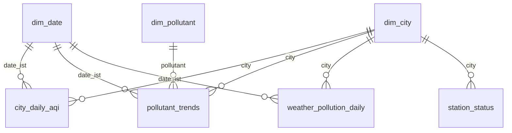

# Dashboards — Databricks AI/BI + Power BI

Both read **Gold** through one **SQL Warehouse** (serverless 2X-Small, 1-min auto-stop). The web app does **not** use the warehouse; it reads Supabase.

## 1. Databricks AI/BI dashboard ("dashboard as code")

- File: `databricks/dashboards/aeris.lvdash.json`, deployed by the bundle resource `databricks/resources/aeris_dashboard.yml` (`warehouse_id` is a bundle variable).
- Workflow: build it in the UI on real Gold data → `databricks bundle generate dashboard --existing-id <id>` (or `--watch` while editing) → commit the JSON → `bundle deploy` recreates it anywhere. The examiner sees the dashboard **and** its source in git.
- Datasets: fully qualified `aeris_brick.gold.*` names (unqualified names have caused deploy errors).

| Page | Visuals |
|---|---|
| Overview | counters (current NAQI per city), line (daily NAQI by city, 90 days), bar (city ranking today), category distribution |
| Pollutants | PM2.5 / PM10 / NO₂ / O₃ daily trends with the NAAQS line; % of days exceeding the limit per city |
| Weather | scatter: PM2.5 vs wind speed and humidity; table of Pearson r per city |
| Stations | map (lat/lon points colored by category); stale-station table |
| Pipeline ops | rows per layer (`ops.table_stats`), sync history (`ops.sync_runs`), quarantine counts, job run timeline (`system.lakeflow` tables, if accessible) |
| Cost (FinOps) | DBUs per day by product from `system.billing.usage` (if system tables are enabled) |

- **Embedding in the web app:** a workspace admin adds the web domain (Vercel URL) under *Settings → Security → Embed dashboards → approved domains*. In the dashboard: *Share → Embed* → copy the iframe `src` (`…/embed/dashboardsv3/<id>`) → `NEXT_PUBLIC_DATABRICKS_DASHBOARD_EMBED_URL`. Viewers must be signed in to Databricks and allow third-party cookies, which is fine for the demo laptop. Fallback: exported PNGs + an "Open in Databricks" link.
- Optional stretch: an **AI/BI Genie space** on the Gold tables ("Ask AERIS": natural-language questions like "worst city last week?").

## 2. Power BI report — enterprise-grade

### Connection

*Get Data → Azure Databricks* → Server hostname + HTTP path (from SQL Warehouse → Connection details) → **Import** mode → sign in with the Microsoft Entra ID (university) account. Select the `aeris_brick.gold` tables. Import mode means the warehouse runs only during a refresh (minutes), never while someone browses the report.

### Model (star schema)

- `dim_date` = a DAX `CALENDAR` over the data range, **marked as the date table**; columns Year, Month, MonthName, Week, Weekday, Season (Winter/Summer/Monsoon/Post-monsoon, which matters for Delhi).
- Single-direction relationships, dimension → fact. Hide keys. Measures live in a dedicated `_Measures` table with display folders and descriptions.
- Theme JSON `powerbi/aeris-theme.json` uses the design tokens and AQI colors from [design.md](design.md).

### DAX measures (`powerbi/measures.dax`)

| Measure | Definition (idea) |
|---|---|
| `NAQI (avg)` | `AVERAGE(city_daily_aqi[naqi])` |
| `NAQI (max)` | `MAX(city_daily_aqi[naqi])` |
| `Very Poor+ Days` | count of days with category in {Very Poor, Severe} |
| `PM2.5 avg` | `CALCULATE(AVERAGE(pollutant_trends[avg_value]), dim_pollutant[pollutant] = "pm25")` |
| `% Days over NAAQS` | `DIVIDE(count(exceeds_naaqs = TRUE), count(all days))` for the selected pollutant |
| `NAQI 7-day rolling` | `AVERAGEX(DATESINPERIOD(dim_date[Date], MAX(dim_date[Date]), -7, DAY), [NAQI (avg)])` |
| `NAQI vs last month` | `[NAQI (avg)] - CALCULATE([NAQI (avg)], DATEADD(dim_date[Date], -1, MONTH))` |
| `Pearson r (PM2.5, wind)` | covariance / (σx·σy) with `SUMX` over the days in context |
| `Data freshness (h)` | `DATEDIFF(MAX(station_status[last_observed_at]), UTCNOW(), HOUR)` |
| `Selected pollutant value` | driven by a **field parameter** (PM2.5 / PM10 / NO₂ / O₃) |

### Report pages (PBIR)

1. **Executive overview:** KPI cards (NAQI today, Very Poor+ days, % days over NAAQS, freshness), NAQI trend with 7-day rolling, city ranking, category donut (≤ 6 slices).
2. **City comparison:** small multiples per city; matrix (city × month) with AQI conditional formatting.
3. **Pollutant deep-dive:** a field-parameter slicer switches the pollutant; NAAQS constant line; season breakdown.
4. **Weather vs pollution:** scatter with trend line; Pearson r cards; wind-speed bins.
5. **Stations map:** map visual (Azure Maps if the tenant allows, otherwise the built-in map) colored by category → **drill-through** to *Station detail* (48 h series, last readings).
6. **Data quality:** rows per layer, last sync, quarantine rate (from `ops.table_stats` / `ops.sync_runs`).

Enterprise extras: bookmarks (Winter vs Summer view), report-page tooltips, **RLS role** `CityViewer` (filter `dim_city[city]`, shown with "View as role"), descriptions on every measure, and **PBIP + PBIR in git** (Power BI as code).

### How Claude builds it (MCP + files)

1. Desktop (installed) → *Options → Preview features* → enable *Power BI Project (.pbip) save option* (and PBIR, if still listed) → **save as `powerbi/AERIS.pbip`**.
2. Connect Power BI Desktop to the warehouse yourself (the sign-in needs you). Load the Gold tables.
3. Claude adds Microsoft's **Power BI Modeling MCP** (`@microsoft/powerbi-modeling-mcp`, preview) to Claude Code and, against the open model, creates `dim_date`, relationships, measures, display folders, the RLS role and descriptions.
4. Claude writes the report pages/visuals as **PBIR** files (`AERIS.Report/definition/pages/*/visuals/*/visual.json`). You close and reopen the `.pbip` in Desktop to load them, since Desktop has no live-edit API for visuals.
5. If any PBIR visual fails to load, the fallback is a step-by-step list here to build that visual by hand (about 2 minutes each).
6. Verify: card totals = a Databricks SQL query on the same Gold table (screenshot both).

### Publish + show in the web app

- *Publish* → the university workspace. In the Service, set the dataset credentials (Databricks OAuth) → scheduled refresh (e.g. 2× per day; no gateway needed, because it's a cloud source).
- Web embed, best available option first:
  1. *File → Embed report → Publish to web* (public iframe), **if the university tenant allows it** (admins often disable it).
  2. *Embed → Website or portal* (secure iframe; viewers sign in), which works on the demo laptop.
  3. Exported PDF/PNG pages in the Dashboards screen + the `.pbip` in git.
- `NEXT_PUBLIC_POWERBI_EMBED_URL` holds whichever URL works.
